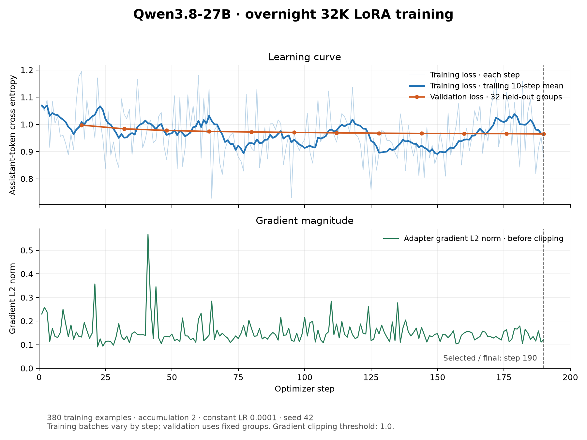
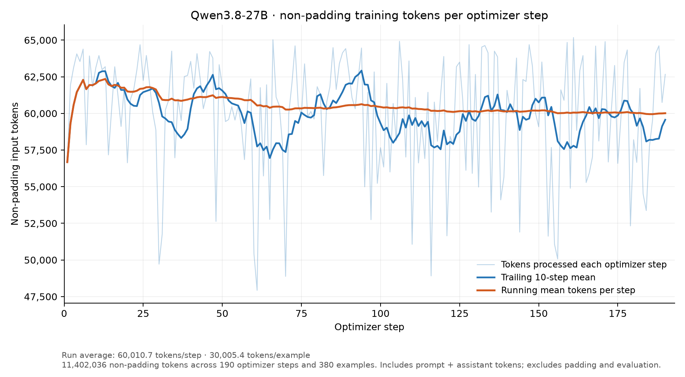

# Qwen3.8-27B LoRA training proof of concept

A reproducible, single-GPU [LLaMA-Factory](https://github.com/hiyouga/LLaMA-Factory) workflow for fine-tuning [Qwen/Qwen3.8-27B](https://huggingface.co/Qwen/Qwen3.8-27B) on text trajectories from [TerminalHorizon-3K](https://huggingface.co/datasets/shunzou05/TerminalHorizon-3K).

**Measured on one NVIDIA B300:** the 2K smoke test passed training, adapter saving, and fresh-process reload. A 32K forward/backward/optimizer capacity probe also passed. The 32K learning pilot completed **32 optimizer steps / one epoch** and passed fresh-process adapter verification. Reloaded held-out loss decreased by **7.56%**. A follow-up output screen produced complete structured responses on **4/4** contexts for the adapter versus **1/4** for the base; actual task success remains unmeasured.

The overnight scaling run subsequently passed training and reload verification at **190 steps**, reducing new test loss by **9.39% versus base** and **1.77% versus the pilot**.

## Results

Recorded November 23–24, 2026. Small machine-readable evidence is committed under [`results/`](results/); weights, checkpoints, and dataset text are not included.

### Completed 2K smoke test

| Measurement | Result |
| --- | --- |
| Prepared dataset | 32 intact excerpts, at most 2,048 formatted tokens |
| Optimizer steps | 10 / 10 |
| Trainer runtime | 33.38 seconds |
| Trainable LoRA parameters | 58,363,904 |
| Mean training loss / final-step loss | 0.828033 / 0.875989 |
| Peak allocated / reserved GPU memory | 58.76 / 71.87 GiB |
| Gradient and update checks | Finite losses/norms; nonzero adapter gradients; 992 adapter tensors changed |
| Fresh-process verification | Passed: forward loss 0.655766 and 16 generated tokens |

This smoke test establishes that training and the saved adapter work. Its reload loss is on a prepared training example, **not a held-out quality measurement**. The 10 steps visit a subset of the 32-example dataset. [Full smoke-test metrics](results/smoke_test.json).

### Completed 32K learning pilot

| Measurement | Result |
| --- | --- |
| Context cutoff | 32,768 tokens; no 16K fallback needed |
| Capacity-probe example | 32,759 tokens |
| Capacity check | Two accumulated backward passes and one optimizer step passed |
| Probe peak allocated / reserved GPU memory | 179.10 / 197.47 GiB |
| Pilot split | 64 training / 16 validation trajectories from 80 distinct task groups |
| Prepared training lengths | 20,517–32,759 tokens, 12–44 messages |
| Prepared validation lengths | 24,575–32,241 tokens, 10–32 messages |
| Planned / completed / saved steps | 32 / 32 completed; checkpoint 32 saved (checkpoints 24 and 32 retained) |
| Base-model validation loss | 1.077827 |
| Adapter validation loss, step 32 (trainer) | 0.996254 |
| Reloaded adapter validation loss | 0.996313 |
| Relative held-out loss reduction after reload | **7.56%** |
| Run status | Passed; completed after resuming from checkpoint 8 |
| Final 32K adapter verification | Passed: finite loss on all 16 held-out examples; four generations completed |
| Training-process peak allocated / reserved GPU memory | 164.74 / 260.44 GiB (resumed process) |
| Adapter update checks | Nonzero gradients; 992 adapter tensors changed during resumed training |

Validation loss is the mean of per-example assistant-token cross entropy over the same 16 held-out examples. The reloaded adapter exceeds the pilot's predefined **5%** learning-signal threshold, and the full training/reload acceptance checks passed. With only 16 held-out tasks, this remains exploratory evidence of imitation learning; it does not establish improved terminal-task completion. No commands from the dataset or model generations are executed.

The held-out curve improved throughout the run:

| Optimizer step | Validation loss |
| --- | --- |
| 0 (base model) | 1.077827 |
| 8 | 1.024374 |
| 16 | 1.008066 |
| 24 | 1.000987 |
| 32 | 0.996254 |
| 32, fresh-process reload | 0.996313 |

**Initial generation check:** all four adapter samples reached the 256-new-token cap; three had not closed their reasoning block. The generation check passed operationally, but these capped samples cannot establish command correctness or task completion. The follow-up 2,048-token screen below assesses response completion; task execution remains untested.

See [pilot evidence](results/pilot_32k.json), [training and validation curves](results/training_curves.csv), and [hardware/runtime versions](results/environment.json). Capacity-probe memory is measured separately from the subsequent training run. Allocated and reserved memory are distinct measurements; reserved memory includes the allocator cache.

### Historical 32K scaling experiment (November 24, 2026)

The fresh overnight adapter completed **190/200 optimizer steps**, processing **380/400 training examples** and **11,402,036 non-padding tokens** before the training deadline. The full experiment, including final evaluation, finished in **11 hours 40 minutes**, with no worker failures, forced shutdowns, or skipped evaluations. Checkpoint **190** was selected using only the new 32-group validation set (loss **0.964965**) and passed fresh-process reload verification. All 992 adapter tensors changed, and training losses and nonzero gradient norms remained finite.

| Model | New test loss (32 groups) | Original anchor loss (16 groups) |
| --- | --- | --- |
| Base | 1.078930 | 1.077827 |
| Existing pilot | 0.995211 | 0.996313 |
| Overnight adapter | **0.977628** | **0.979569** |

The overnight adapter reduced test loss by **9.39% versus base** (paired task-bootstrap 95% interval **8.72–10.07%**) and **1.77% versus pilot** (**1.63–1.91%**). Anchor loss decreased by **9.12% versus base** and **1.68% versus pilot**. These intervals resample held-out task groups and do not measure variation across training seeds. This meets the planned promising-scaling threshold; terminal-task success remains unmeasured.

On the four new test contexts plus four controlled instruction probes, both adapters produced **8/8 schema-valid responses**, with **zero truncations** and **4/4 instruction probes passed**. Base produced **7/8 schema-valid responses**, one truncation, and also passed all four instruction probes. Decoding was greedy with 2,048 output tokens per response. Generated commands were not executed.



The blue training line is a trailing 10-step mean; faint blue shows individual batches. Orange shows validation on the same 32 held-out groups at each completed evaluation. Training batches contain different tasks at each step, so their fluctuations are not a fixed-set quality estimate. The lower panel reports the total adapter gradient L2 norm **before** clipping (threshold 1.0). The dashed line marks the selected final checkpoint, step 190.



Training averaged **60,010.7 non-padding tokens per optimizer step**, or **30,005.4 tokens per example** with two examples accumulated per step. The orange line is the running mean across completed steps; blue shows the trailing 10-step mean and faint blue shows each step. Counts come from differences in the cumulative training-token counter and include prompt and assistant tokens, excluding padding and evaluation. See the [per-step token counts and averages](results/overnight_tokens_per_step.csv) and [vector figure](results/overnight_tokens_per_step.svg).

See [full metrics and uncertainty intervals](results/overnight_32k.json), [training data for the plot](results/overnight_training_curves.csv), [validation data for the plot](results/overnight_validation_curves.csv), and the [vector figure](results/overnight_learning_curves.svg). The metrics export excludes prompts, generated responses, absolute paths, and weights. [Read the full paired model responses](results/overnight_paired_responses.md) to compare base, pilot, and overnight outputs on all eight cases. This separately published comparison includes exact model outputs with formatting checks; prompt transcripts and weights remain in local scratch storage.

## Output-quality screen

A separate paired comparison used the same four validation contexts, greedy decoding, `xhigh` reasoning effort, and **2,048 new tokens per response**. It also included four short exact-action instruction/format probes. Generated commands were never executed.

| Check | Base | Trained adapter |
| --- | --- | --- |
| Complete, schema-valid responses on real contexts | **1/4** | **4/4** |
| Real-context responses reaching the token cap | 3/4 | 0/4 |
| Exact-action instruction probes passed | 4/4 | 4/4 |

The adapter produced concrete next actions for all four contexts; the base model spent its budget reasoning without final JSON in three. Static inspection found plausible source-inspection and measurement steps, but also an unverified gateway request-payload assumption. Two reference responses themselves exceed 2,048 tokens, so capped outputs are budget-limited evidence, not proof of task failure.

This is a small usability screen, **not a task-success score or a general model-quality ranking**. The exact-action probes provide the desired action and therefore measure instruction following rather than independent problem solving. See the [case-level metrics](results/quality_comparison.json) and [context-based review and limitations](results/quality_review.md).

To reproduce against your completed 32K pilot:

```bash
export PILOT_RUN="$SMOKE_ROOT/runs/pilot-<your-completed-run-id>"
./setup.sh --run quality --pilot-run "$PILOT_RUN" --max-new-tokens 2048
```

A new directory under `$PILOT_RUN/quality/` contains the paired responses, prompt hashes, stage logs, summary, and a local `comparison.md` with complete responses and the reference next turns. The reference responses are never supplied to the model.

## Reproduce

This was tested on Linux with one B300 (approximately 269 GiB VRAM). Other hardware is untested. Use a fast scratch filesystem with room for roughly 56 GB of model weights plus the environment, caches, data, and checkpoints. The scripts check CUDA, BF16, a CUDA matrix multiplication, free GPU memory, and package consistency.

```bash
git clone https://github.com/interactivetech/qwen38-27b-llamafactory-poc.git
cd qwen38-27b-llamafactory-poc

# Set this to your own fast scratch directory before installing or running.
export SMOKE_ROOT=/path/to/fast-scratch/qwen38-27b-llamafactory-test
./setup.sh

# Original installation/training/save/reload smoke test.
./setup.sh --run all

# New 32K learning pilot; retry once at 16K only on CUDA OOM.
./setup.sh --run pilot --seq-len 32768 --fallback-seq-len 16384 \
  --examples 64 --eval-examples 16
```

Each pilot creates a timestamped run directory under `$SMOKE_ROOT/runs/`. The original smoke adapter is protected against overwrite. For another independent smoke run, use another scratch root; do not delete a saved adapter to rerun it. No external experiment reporting, quantization, DeepSpeed, optional attention kernels, or full-model merging is enabled.

The final report records **130.19 minutes** of accumulated pipeline elapsed time, including the initial interrupted attempt and resumed execution through verification; the pause between runs is excluded. The resumed trainer invocation reported **80.32 minutes**, including its scheduled evaluations; this is not a full uninterrupted-training timing. Reference PyTorch kernels are intentionally used and are slow at long context lengths.

### Resume a stopped pilot

Data, the base-model baseline, the capacity probe, and the checkpoint must already exist locally; they are not downloaded from this repository. Point `PILOT_RUN` at your run directory. Resume selects its latest saved checkpoint, continues to the original step budget, and automatically runs final adapter verification.

```bash
export PILOT_RUN="$SMOKE_ROOT/runs/pilot-<your-run-id>"
nohup ./setup.sh --run pilot --phase resume --run-dir "$PILOT_RUN" \
  > "$PILOT_RUN/resume.log" 2>&1 &
tail -f "$PILOT_RUN/resume.log"
```

The published completed run's ID is `pilot-20261123T191916743546Z`. It resumed from checkpoint 8 and finished at step 32. Its final adapter is under `context-32768/adapter/` in scratch. The resume example above is for other unfinished runs; the runner refuses to restart this already verified run. Press Ctrl-C to stop following the log without stopping the `nohup` job. A resumed run records errors and stops; it does not silently restart training at a different context length. Use `--seq-len 16384` when resuming a run that had already fallen back to 16K.

## Method and pinned stack

- **Data:** stream the pinned source in stable order; deduplicate and retain one trajectory per normalized initial task prompt, excluding its volatile terminal-state section. Seed 42 assigns 80 eligible task groups to the two disjoint splits. A fallback keeps those same source trajectories and split assignments.
- **Formatting:** longest intact initial conversation prefix ending in an assistant turn. Preserve reasoning, JSON commands, observations, and roles. Use `qwen3_8` and ShareGPT `role`/`content` fields; mask user messages and padding. Tokenized data is checked against the template before training.
- **Pilot training:** fresh BF16 base model, LoRA rank 8 / alpha 16 / dropout 0; supported language-model linear layers only. Base and vision weights stay frozen. Microbatch 1, accumulation 2, gradient checkpointing, no packing, AdamW at 1e-4 with a constant schedule, 32 optimizer steps / one epoch.
- **Evaluation:** unadapted baseline on 16 held-out examples; validation and resumable checkpoints every 8 steps; keep two checkpoints. Final verification reloads the saved tokenizer and unmerged adapter in a fresh process, repeats held-out loss, and compares four fixed base/adapter generations, capped at 256 new tokens each.

| Component | Pinned revision/version |
| --- | --- |
| Model revision | `37561816e66b5b9153b1b64c10968c18c1e6f4a0` |
| Dataset revision | `45f1e98e317d3639437f0eb02f4e8bc5825732f3` |
| LLaMA-Factory commit | `8ebba0d07dd14fdb1d429c497f018c7dae2e44b7` |
| Managed Python | 3.12.12 |
| PyTorch / torchvision / torchaudio | 2.10.0 / 0.25.0 / 2.10.0, CUDA 13.0 wheels |
| Transformers | 5.17.0 |
| Attention | PyTorch SDPA and standard model kernels |

The complete dependency resolution is in [`requirements.lock`](requirements.lock), with LLaMA-Factory pinned to its Git commit. Setup uses that lock for a fresh scratch environment and retains an existing scratch lock when rerun.

The pinned Factory checkpointing wrapper does not accept the new default `every_n_layers=1` / `offload=False` arguments passed by Transformers 5.17. The runner applies an explicit runtime compatibility wrapper for those defaults and rejects nondefault settings. Package source files and dependency constraints are not modified.

## Files, checks, and updating results

- [`setup.sh`](setup.sh): scratch environment, dependency lock, and CUDA checks.
- [`smoke_test.py`](smoke_test.py), [`smoke_lora.yaml`](smoke_lora.yaml): smoke workflow and shared training defaults.
- [`pilot_test.py`](pilot_test.py): split preparation, capacity probe, baseline, training, resume, and verification.
- [`quality_test.py`](quality_test.py): bounded paired output comparison and mechanical checks; no generated command execution.
- [`test_pilot.py`](test_pilot.py) and [`test_quality.py`](test_quality.py): CPU tests for workflow/resume behavior, response parsing, and exact-action oracles. These do not run GPU training.
- [`PILOT.md`](PILOT.md) and [`PLAN.md`](PLAN.md): detailed workflow and original experiment history. Original machine paths in the historical notes are examples; set `SMOKE_ROOT` for your system.

Run the CPU tests using the installed environment:

```bash
TMPDIR="$SMOKE_ROOT/tmp" PYTHONPYCACHEPREFIX="$SMOKE_ROOT/cache/pycache" \
  "$SMOKE_ROOT/venv/bin/python" -m unittest -v test_sft test_sft_telemetry test_pilot test_quality
```

After continuing training, refresh the committed evidence from your actual run artifacts:

```bash
"$SMOKE_ROOT/venv/bin/python" export_results.py \
  --root "$SMOKE_ROOT" --pilot-run "$PILOT_RUN" --output results
```

The exporter allowlists metrics and omits dataset text, generated responses, absolute paths, and model/checkpoint files. If a final report exists, the JSON snapshot records the completed result; until then, it explicitly records a partial run. Update the README results table to match the new snapshot before publishing another commit.

This is an installation and training feasibility proof of concept with exploratory held-out loss measurements. An executable Terminal-Bench pilot is implemented, but no scored benchmark results have been established yet. The upstream model, dataset, and framework remain separate projects with their own terms and licenses.

## SFT training, progress, and W&B

The reusable training command is `./setup.sh --run sft`. See [SFT.md](SFT.md) for launch, live progress, tracking setup, offline synchronization, and resume instructions. The defaults retain the proven 12-hour 32K experiment configuration. Smoke and pilot commands are unchanged.

Interactive terminals show progress bars; redirected `training.log` output contains step metrics, evaluation/generation counts, heartbeats, checkpoint saves, and an explicit final status. W&B records locally by default and attempts online tracking when `WANDB_API_KEY` is present. Tracking dependencies and network work are isolated from the training environment and watchdog. Metrics and configuration are uploaded; prompts, responses, weights, source code, and raw console logs stay local.

For an existing pilot installation, run `./setup.sh --setup-tracking` once. Use `--wandb-mode disabled` to run without W&B installed. Local/offline tracking has no hosted dashboard until synced; online runs print their URL. Connection failures retain local metrics and allow training to continue.

```bash
RUN_DIR=$(cat "$SMOKE_ROOT/latest_sft_run.txt")
./setup.sh --tracking sync --run-dir "$RUN_DIR"
"$SMOKE_ROOT/venv/bin/python" export_sft_results.py --run-dir "$RUN_DIR" --output results
```

New exports use `sft_*` filenames. `--run overnight` and the old Python entrypoints remain deprecated aliases; the legacy exporter preserves `overnight_*` filenames. Historical published results and response links above retain their original names. Add `--include-responses` only when explicitly refreshing a published response comparison. Plotting uses Matplotlib from the pinned training environment.

## Terminal-Bench 2.1 evaluation

The approved five-task base-versus-checkpoint-190 pilot is implemented in
`terminalbench.py`. Install its isolated environments with `./setup.sh --setup-eval`.
See [TERMINALBENCH.md](TERMINALBENCH.md) for container calibration, the single-pair
integration check, the full three-hour command, resume/reporting, and sanitized
exports. Setup and CPU tests do not launch the comparison or interrupt training.
Numerical merge/serving differences are advisory and documented for future
investigation; checkpoint integrity, exact adapter loading, tokenizer agreement,
and container calibration remain mandatory. The initial pilot was stopped at the
user's request before model scoring; use a fresh run directory for the manual run.
